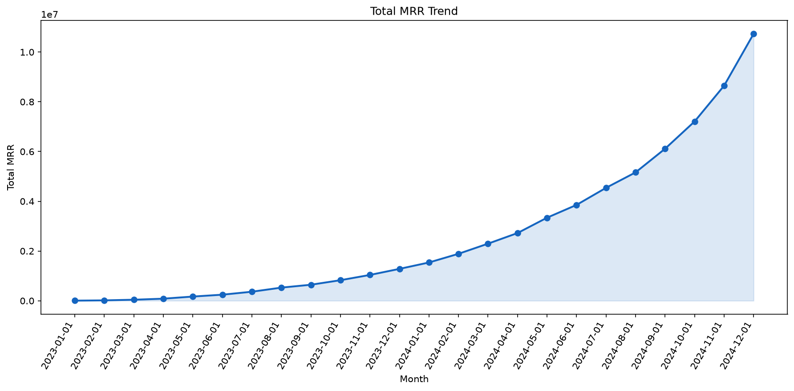
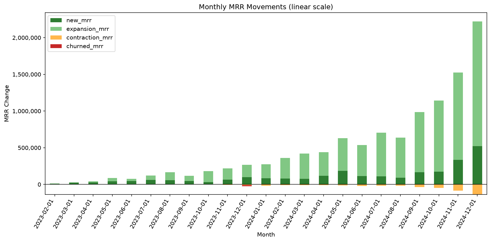
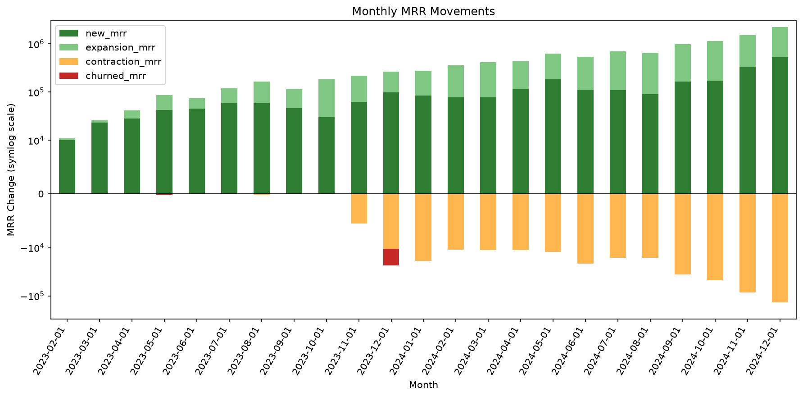
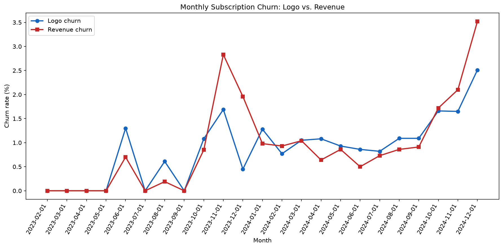
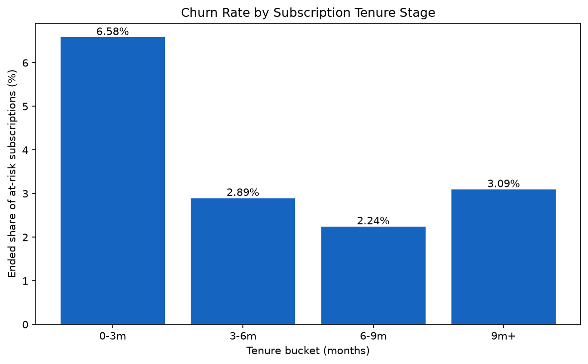
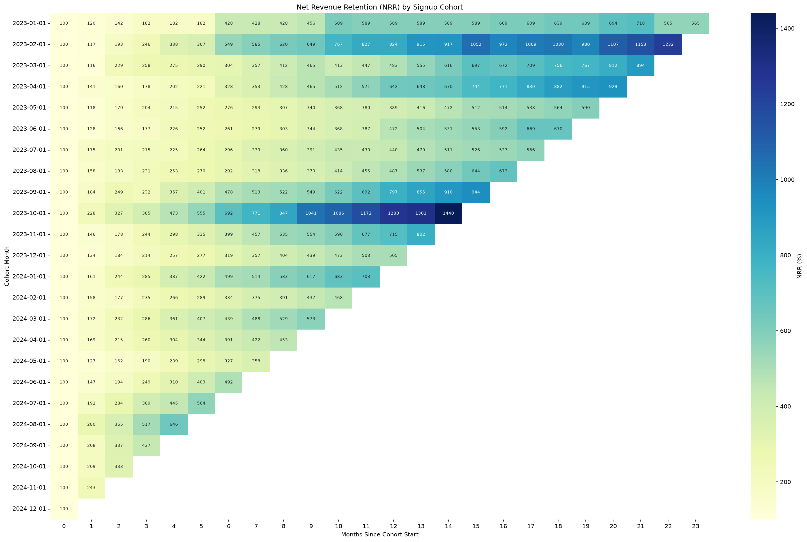
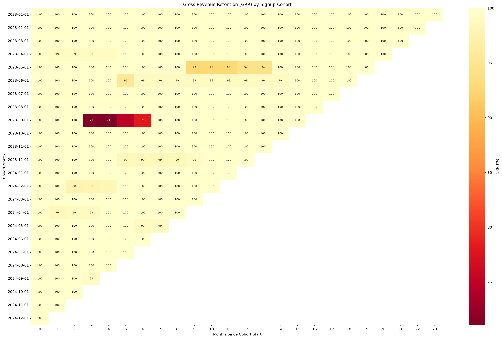
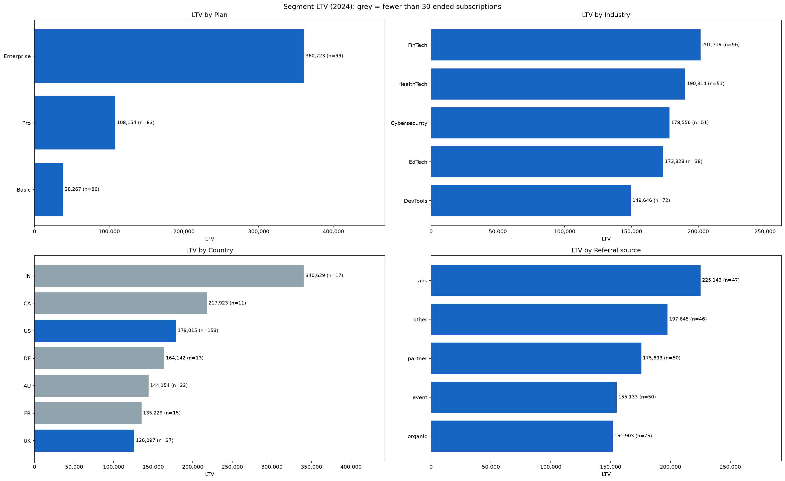

# B2B SaaS Subscription Revenue Analytics

SQL and Python analysis of a B2B SaaS subscription dataset: MRR and ARR, churn, cohort retention and customer lifetime value (LTV). Period: January 2023 to December 2024.

**Stack:** SQLite (in-memory), pandas, matplotlib, seaborn, Jupyter
**Dataset:** RavenStack (Kaggle): accounts (500 rows), subscriptions (5,000), churn_events (600), feature_usage (25,000), support_tickets (2,000)

## Executive Summary

- **Growth:** MRR grew from 4,684 (2023-01) to 10.73M (2024-12). ARR reached 128.8M, up 737% year over year. Early-2024 YoY values are inflated by the small 2023 base.
- **Growth driver:** Expansion drives growth. Losses come mostly from contraction. Only one account-level churn event exists (2023-12, -12,736).
- **Churn:** Monthly subscription churn is mostly 0.5-1.7% and rises in Q4 2024 (2024-12: 2.51% logo, 3.52% revenue). The first 90 days are the riskiest stage.
- **Retention:** NRR rises far above 100% in several cohorts, while GRR stays between 71% and 100%.
- **Segments:** Enterprise generates 75% of MRR and has the highest LTV (360,723).

## Repository Structure

```
.
├── data/                      # source CSV files (download from Kaggle, not versioned)
├── queries/                   # 27 numbered SQL files, in notebook order
├── reports/assets/            # exported charts (PNG)
├── mrr_analysis_clean.ipynb   # full analysis
└── README.md
```

`queries/08_mrr_views.sql` creates three views (`account_month_mrr`, `mrr_movements`, `monthly_mrr`). Run it before the queries that read from them (09 onward). Each file has a short header: title, question and source.

## Data Quality Checks

| Check | Result |
|---|---|
| Trial rows | 778 trial rows, all with MRR 0. No paid row has MRR 0. |
| Subscriptions per account | About 10 concurrent subscriptions per account (5,000 rows, 500 accounts). |
| Accounts with no active paid subscription | 0 |
| `churn_flag` vs `end_date` | `churn_flag = 1` on exactly the 486 rows with an end date. |
| `churn_events` vs `churn_flag` | In both sources: 227 accounts. Only events: 125. Only flag: 85. Neither: 63. |

**Decisions:**
- Account-level monthly MRR is derived from `subscriptions`.
- Churn means account MRR drops from positive to 0. Reactivation is a separate row.
- `churn_events` is used for churn reasons only, because the two sources disagree.
- A subscription whose `end_date` is the first day of a month counts as active in that month.

## Financial KPIs

| KPI | 2024-06 | 2024-12 |
|---|---|---|
| MRR | 3,854,007 | 10,734,251 |
| ARR (MRR x 12) | 46,248,084 | 128,811,012 |
| MoM growth | 15.40% | 24.13% |
| YoY growth | 1,478.88% | 737.17% |
| Logo churn | 0.86% | 2.51% |
| Revenue churn | 0.50% | 3.52% |
| Gross revenue churn | 0.64% | 1.58% |
| Net revenue churn | -12.01% | -18.09% |

In 2024-06 there are 1,470 paid subscriptions with an average MRR of 2,621.77. Net revenue churn is negative in all 24 months: expansion outweighs losses.

### MRR



The waterfall is shown on a linear and a symlog scale. The symlog version only makes small values (contraction, churn) visible.




### Churn



Churn by tenure (ended share of at-risk paid subscriptions): 6.58% (0-3 months), 2.89% (3-6), 2.24% (6-9) and 3.09% (9+).



### Cohort Retention

500 accounts form 24 monthly cohorts. NRR reaches 1,449% for the 2023-10 cohort at month 14 (an outlier driven by expansion). GRR is capped per account at its starting MRR: minimum 71.07% (2023-09 cohort), maximum 100%.




### Segmentation and LTV

LTV = average 2024 ARPU per subscription / weighted monthly churn (ended subscriptions / paid subscriptions, 12 months).

| Plan | ARPU (2024-06) | Monthly churn | LTV | Ended subs |
|---|---|---|---|---|
| Enterprise | 5,899 | 1.56% | 360,723 | 99 |
| Pro | 1,420 | 1.33% | 108,154 | 83 |
| Basic | 530 | 1.40% | 38,267 | 86 |

| Segment | Top | LTV | Bottom | LTV |
|---|---|---|---|---|
| Industry | FinTech | 201,719 | DevTools | 149,646 |
| Country | IN | 340,629 | UK | 126,097 |
| Referral source | ads | 225,143 | organic | 151,903 |



## Strategic SaaS Recommendations

1. **Protect Enterprise accounts.** Enterprise brings 75% of MRR and has an LTV about 3.3x Pro's. It also has the highest monthly churn of the three plans, so retention work should start here.
2. **Strengthen the first 90 days.** Churn in the first 90 days (6.58%) is about two to three times higher than in later stages. Onboarding is the most effective place to reduce losses.
3. **Keep expansion as the growth engine and watch contraction.** Expansion drives growth, and contraction is the main source of losses. Contraction grew in absolute terms in late 2024.
4. **Investigate the Q4 2024 churn increase.** Logo churn reached 2.51% in 2024-12, above the usual 0.5-1.7% band.
5. **Favor ads, review organic retention.** Ads has the highest LTV among referral sources. Organic has the highest ARPU (2,859) but the highest churn (1.88%) and the lowest LTV.
6. **Monitor IN, do not act yet.** IN ranks first by country, but it rests on only 17 ended subscriptions.

## Methodology Notes and Limitations

- 2023-01 shows all MRR as `new` because the month grid starts there.
- Contraction is left as-is and is not reclassified.
- Churn losses are counted in the `end_date` month, so they appear one month earlier than in the MRR views.
- Subscription-level churn is higher than account-level gross churn, because other subscriptions on the same account offset a loss.
- Tenure buckets are not directly comparable: 9+ months is open-ended, and active subscriptions that have not completed a bucket remain in the denominator.
- Early cohorts are very small (2023-01: 2 accounts, 2023-02: 7), so their rates are noisy.
- GRR is capped per account, so it is not strictly decreasing.
- LTV uses weighted churn. Expected lifetimes extend beyond the 24 months of data and are projections.
- Industry rankings are within noise. In 5 of 7 countries, LTV rests on fewer than 30 ended subscriptions.
- Upgrade and downgrade flags do not follow plan order, so they are indicators, not direction. No transition matrix can be built from them.

## How to Run

1. Download the RavenStack dataset from Kaggle and place the five CSV files in `data/`.
2. Install dependencies: `pip install pandas matplotlib seaborn jupyter`.
3. Open `mrr_analysis_clean.ipynb` and run all cells. Charts are saved to `reports/assets/`.
